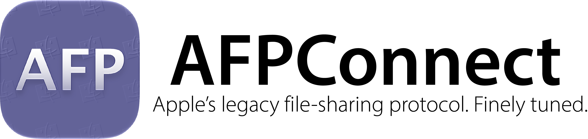
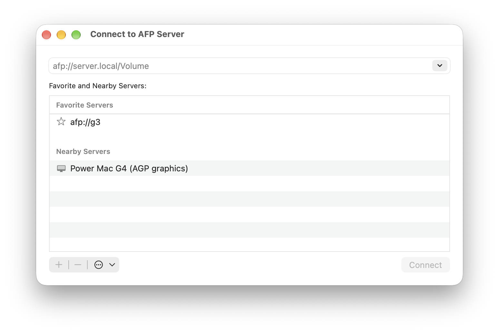

**AFPConnect** is an Apple Filing Protocol (AFP) client for macOS 27. By enabling users to once again share files with legacy Macs running AFP servers, it re-establishes 29 years' worth of file-sharing continuity.

Apple first released a TCP/IP client and server for AFP in 1997 with AppleShare IP, and although SMB replaced AFP as the default file-sharing protocol with the 2013 release of OS X Mavericks, Apple continued shipping the AFP server until 2020 with its removal in Big Sur. With the recent release of macOS 27 Golden Gate, Apple has removed the AFP client software from the operating system, preventing users from natively sharing files with older Macs without resorting to SMB (which has spotty support for Mac-specific attributes like resource forks and type/creator codes). AFPConnect, on the other hand, implements all the standard Mac filesystem features, and does not enforce the protocol security requirements Apple's AFP client did, allowing compatibility all the way back to 1997.

AFPConnect runs in userspace as an FSKit filesystem extension and provides a share-mounting UI that closely replicates the Finder's "Connect to Server" flow. It is compatible with all Apple silicon Macs running macOS 27 and is free software, distributed under the GNU General Public License version 2.

AFPConnect is based on the [netatalk-client](https://github.com/Netatalk/netatalk-client) library, which provides the core AFP client implementation. AFPConnect extends netatalk-client by hooking it into FSKit, providing a GUI, and implementing the AppleDouble file format needed for macOS to use extended filesystem features.

## Features

- Compatibility with all TCP/IP AFP servers
- Native Mac user interface, with close parity to Finder's Connect to Server interface
- Support for Classic Mac OS resource forks and type/creator codes, Mac OS X extended attributes, and file permissions
- Automatic discovery of AFP servers advertised via Bonjour on your local network
- Sandboxed, notarized app, with a userspace filesystem extension, not a kext
- Command-line mounting support for scripting

## Known Issues

Saving passwords to the keychain doesn't function properly right now.

## Testing

AFPConnect has been tested against AFP servers running on virtualized copies of Mac OS 7.6.1, 9.2.2, 10.1, 10.2, 10.3, 10.4, 10.6, 10.7, and 10.15. Limited testing has been conducted on real hardware (on an iMac G3 running 9.2.2 and 10.4).

## Source Code

The source code to AFPConnect is available via Git. The repository is hosted [on GitHub](https://github.com/benjamin-lowry/AFPConnect) and [on Sourcehut](https://git.sr.ht/~blowry/AFPConnect).

The source code is also available as a .tar.gz archive. [Click here to download the source code for the latest version.](https://appdl.benjaminlowry.com/afpconnect/AFPConnect_1.0.0.tar.gz)

## License

Copyright (C) 2026 Benjamin Lowry
  
AFPConnect uses [netatalk-client](https://github.com/Netatalk/netatalk-client)  
Copyright (C) 2006 Alex deVries <alexthepuffin@gmail.com>  
Copyright (C) 2007 Derrik Pates <dpates@dsdk12.net>  
Copyright (C) 2024-2026 Daniel Markstedt <daniel@mindani.net>  
Copyright (C) 2026 Andy Lemin (andylemin)  
  
AFPConnect is free software; you can redistribute it and/or modify it under the terms of the GNU General Public License version 2 as published by the Free Software Foundation.
  
AFPConnect is provided in the hope that it will be useful, but it comes with ABSOLUTELY NO WARRANTY, to the extent permitted by applicable law.  